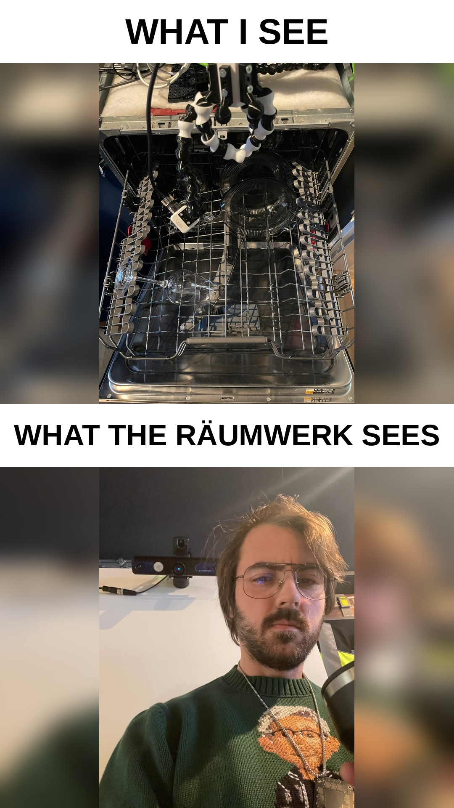
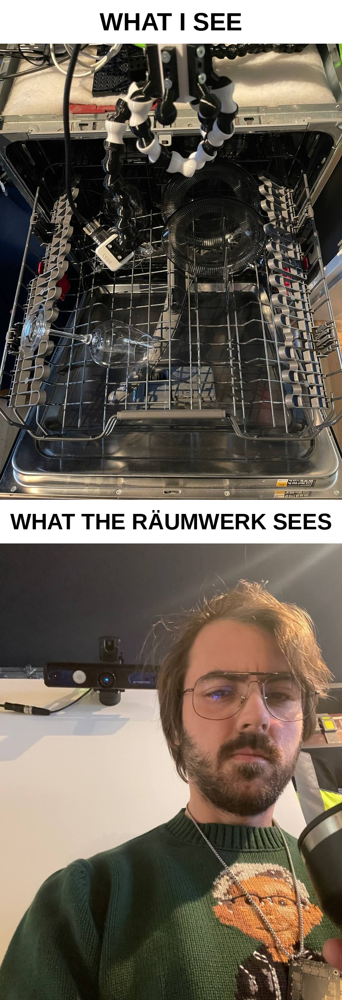

# Memes

Was wir sehen, und was das Räumwerk sieht. Die Stereokamera (Ensenso C57) blickt aus etwa 1,4 m von oben auf den Oberkorb. Auf dem Korb kommt bisher nur rund die Hälfte der Bildpunkte mit gültiger Tiefe an, Gitterdrähte und Glas fehlen oft. Daran arbeiten wir.

Querformat:

